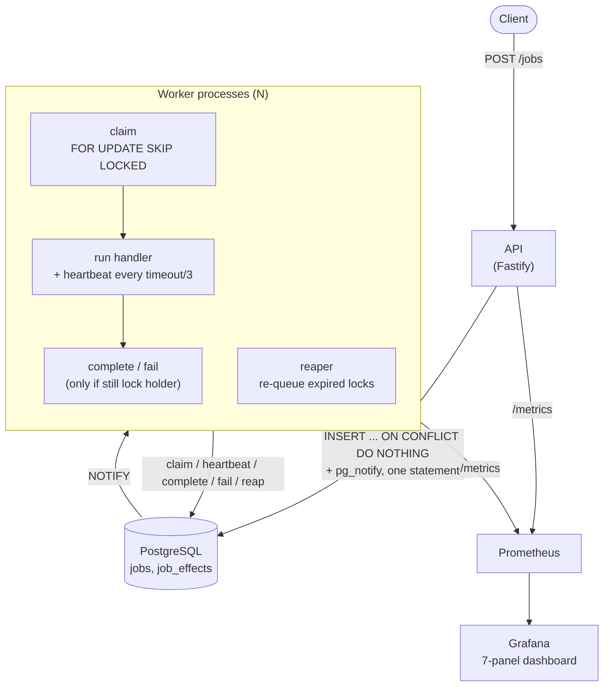
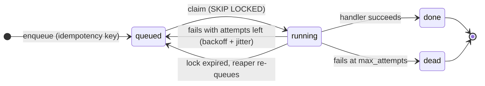
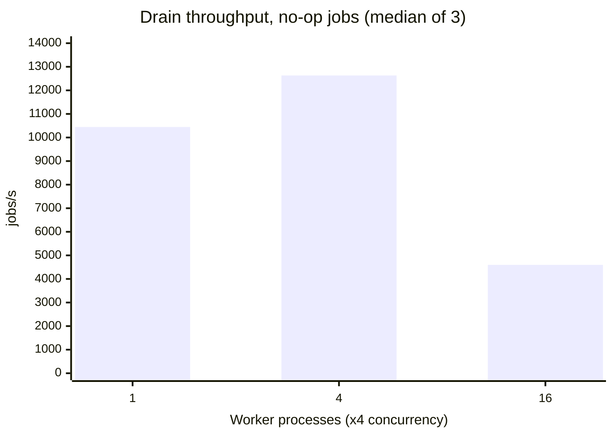

# pg-durable-queue

[](https://github.com/byteKumar/pg-durable-queue/actions/workflows/ci.yml)

A durable background-job queue built only on PostgreSQL, in TypeScript. A REST API enqueues
jobs, worker processes claim them with `FOR UPDATE SKIP LOCKED`, and jobs survive worker
crashes without being lost or applied twice.

## Results at a glance

Measured on one 8-core laptop (Apple M3, 16 GB, PostgreSQL 14). Details in [RESULTS.md](RESULTS.md).

- **Crash test:** 1,000,000 jobs across 20 runs with 530 `SIGKILL`ed workers: **0 lost jobs,
  0 duplicate side effects.**
- **Throughput:** up to **12,632 jobs/s** (4 workers, no-op jobs, median of 3 runs).
- **`SKIP LOCKED` vs naive `FOR UPDATE`:** **1.9× faster** at 16 workers (4,596 vs 2,404 jobs/s).
- **Latency under load:** **2,000 enqueues/s** for 60 s with job wait p99 **19 ms** and 0 errors.
- **Tested:** 43 integration tests against real Postgres, plus a docker-compose smoke test, all
  passing in GitHub Actions.

## Architecture



A job's life:



| File | What it does |
|---|---|
| [`migrations/001_jobs.sql`](migrations/001_jobs.sql) | `jobs` table, partial indexes for ready and running jobs, `job_effects` |
| [`src/queue.ts`](src/queue.ts) | `enqueue`, `claim`, `complete`, `fail`, `heartbeat`, `reap`: one SQL statement each |
| [`src/worker.ts`](src/worker.ts) | Worker loop: concurrency slots, LISTEN/NOTIFY plus 1 s poll, heartbeats, reaper, graceful shutdown |
| [`src/api.ts`](src/api.ts) | `POST /jobs`, `GET /jobs/:id`, `GET /metrics`, `GET /health` |
| [`src/metrics.ts`](src/metrics.ts) | `queue_depth`, `job_wait_seconds`, `job_duration_seconds`, `jobs_total`, `reaped_jobs_total` |
| [`src/migrate.ts`](src/migrate.ts) | Applies `migrations/*.sql` once each, under an advisory lock |
| [`bench/`](bench/) | Crash test, drain benchmark, k6 steady-state load test |
| [`ops/`](ops/), [`docker-compose.yml`](docker-compose.yml) | Prometheus config, Grafana dashboard, full local stack |

## Approach

The goal was a queue that never loses a job, never applies a side effect twice, and needs no
infrastructure beyond the Postgres a team already runs. Each decision below came with a cost.

1. **Claim with one `UPDATE ... WHERE id = (SELECT ... FOR UPDATE SKIP LOCKED LIMIT 1)`.**
   Workers skip rows another worker has locked instead of waiting on them, so they never block
   each other or claim the same job. A partial index holds only `queued` rows, in exactly the
   order the claim reads them. *Trade-off:* strict FIFO is lost under contention, and every
   claim is a row update, which creates vacuum work.

   ```sql
   UPDATE jobs SET status = 'running', locked_by = $1, locked_until = now() + $2::interval,
          attempts = attempts + 1, started_at = COALESCE(started_at, now())
   WHERE id = (SELECT id FROM jobs
               WHERE queue = $3 AND status = 'queued' AND run_at <= now()
               ORDER BY priority DESC, run_at
               FOR UPDATE SKIP LOCKED LIMIT 1)
   RETURNING *;
   ```

2. **At-least-once execution, effectively-once side effects.** Exactly-once isn't possible
   when a worker can die after doing the work but before recording it. So jobs may re-run, and
   side effects are made idempotent instead: enqueue uses `ON CONFLICT DO NOTHING` on an
   idempotency key, and the test handler writes its effect with `ON CONFLICT DO NOTHING` keyed
   by job id. *Trade-off:* every handler has to be written idempotently.
3. **Visibility timeout with heartbeats and a reaper.** A claim takes a lease
   (`locked_until`); a running job extends it every timeout/3. If a worker dies, the lease
   expires and the reaper in any worker re-queues the job. `complete` and `fail` only apply
   while `locked_by` still matches, so a stalled worker can't overwrite a job someone else now
   owns. *Trade-off:* recovery takes up to one visibility timeout.
4. **LISTEN/NOTIFY wake-ups with a 1 s polling fallback.** Idle workers wake within
   milliseconds of an enqueue, and a dropped notification costs at most 1 s. *Trade-off:* one
   extra connection per worker for `LISTEN`.
5. **Retries with exponential backoff and full jitter** (1 s base, 5 min cap), then a `dead`
   state after `max_attempts`, so a failing job can't spin forever or retry in lockstep.
6. **Migrations under a Postgres advisory lock**, so many processes starting at once apply each
   migration exactly once.

**How it was measured.** Everything ran on one laptop: Postgres, the API, the workers and the
load generator.

- The **crash test** pre-loads 50,000 jobs per run, runs 8 worker processes × 4 concurrency
  with a 5 s visibility timeout, and `SIGKILL`s a random worker every 1–3 s until the queue
  drains. It then checks the database: every job `done`, exactly one effect row per job. The
  duplicate count from worker logs is cross-checked against the database.
- The **drain benchmark** times how fast N workers empty 50,000 pre-loaded jobs. It runs each
  case 3 times, interleaved, and reports the median.
- The **steady-state test** drives the API with k6 at a fixed arrival rate for 60 s per step,
  then measures the time from enqueue to claim (job wait) from the database.
- No benchmark was tuned after seeing its numbers.

## Results

### Crash recovery (5 of the 20 runs; all 20 in [RESULTS.md](RESULTS.md))

| Run | Kills | Lost jobs | Jobs run more than once | Duplicate effects absorbed | Wall time |
|---|---|---|---|---|---|
| 1 | 24 | 0 | 88 | 86 | 51.72 s |
| 2 | 27 | 0 | 96 | 94 | 50.70 s |
| 3 | 49 | 0 | 165 | 110 | 92.87 s |
| 4 | 27 | 0 | 94 | 93 | 51.42 s |
| 5 | 23 | 0 | 83 | 74 | 49.67 s |

Across all 20 runs: 1,000,000 jobs, 530 kills, **0 lost jobs, 0 duplicate side effects**.

### Drain throughput (50,000 jobs, median of 3)

| Workers (×4 concurrency) | No-op jobs/s | 10 ms sleep jobs/s |
|---|---|---|
| 1 | 10,445 | 285 |
| 4 | **12,632** | 1,169 |
| 16 | 4,596 | 4,895 |



- I/O-bound jobs scale about 17× from 1 to 16 workers (285 → 4,895 jobs/s).
- No-op throughput **drops** at 16 workers. Sampling `pg_stat_activity` showed the 8-core
  laptop CPU-saturated (0.2% idle), with backends waiting on row locks and the lock manager:
  contention at the head of the queue.
- **`SKIP LOCKED` vs naive `FOR UPDATE`** (16 workers, no-op): 4,596 vs 2,404 jobs/s
  (**1.9×**). Naive was also less predictable (one run fell to 1,317 jobs/s). Neither mode
  ever double-claimed.

### Steady-state latency (k6, 1 API process, 8 workers, 60 s per rate)

| Target rate | Achieved | Enqueue p95 / p99 (ms) | Errors | Job wait p50 / p95 / p99 (ms) |
|---|---|---|---|---|
| 200/s | 199.9 | 4.14 / 32.20 | 0% | 1.0 / 2.8 / 17.6 |
| 500/s | 497.0 | 1.80 / 143.43 | 0% | 0.4 / 1.0 / 15.9 |
| 1,000/s | 999.9 | 1.98 / 58.41 | 0% | 0.2 / 1.2 / 8.7 |
| 2,000/s | 1,979.9 | 77.27 / 265.03 | 0% | 0.2 / 4.9 / 19.0 |
| 4,000/s | 2,345.1 | 2,522 / 2,738 | 0% | saturated |

One API process tops out at about 2,345 enqueues/s on this laptop. That limit is the HTTP
layer, not the queue; going further means running more API processes.

## How to run

Needs Node.js 24 and PostgreSQL. Node 24 runs the TypeScript sources directly, so there's no
build step.

```bash
npm install
cp .env.example .env          # DATABASE_URL and TEST_DATABASE_URL
createdb pgq && createdb pgq_test
npm run migrate
```

Start the API and a worker in two terminals:

```bash
node src/api.ts               # http://localhost:3000
CONCURRENCY=4 node src/worker.ts
```

Enqueue a job and check on it:

```bash
curl -X POST localhost:3000/jobs -H 'content-type: application/json' \
  -d '{"type": "sleep", "payload": {"ms": 100}, "idempotencyKey": "demo-1"}'
curl localhost:3000/jobs/1
```

Worker settings (environment variables): `QUEUE` (default `default`), `CONCURRENCY` (4),
`VISIBILITY_MS` (30000), `SHUTDOWN_TIMEOUT_MS` (30000), `CLAIM_MODE` (`skip_locked` or
`naive`), `METRICS_PORT` (off unless set). API settings: `PORT` (3000), `PG_POOL_MAX` (10),
`LOG_LEVEL` (`info`).

**Full stack with Docker:**

```bash
docker compose up --build
```

This starts Postgres (host port 5433), the API (3000), two workers, Prometheus (9090) and
Grafana (3001, dashboard "pg-durable-queue", login admin/admin).

**Benchmarks** use `DATABASE_URL` and **truncate its tables**. The 16-worker cases need
`max_connections` of about 150 or more, and the steady-state run needs k6.

```bash
npm run bench:crash           # crash test, 5 runs
npm run bench:drain           # drain throughput and latency, 3 runs per case
npm run bench:steady          # k6 against the API at 200 to 6,000 req/s
```

## Tests and CI

```bash
npm test                      # 43 tests against TEST_DATABASE_URL (tables are truncated)
npm run typecheck
```

The tests run against a real Postgres, with no mocks. They cover:

- idempotency under 20 concurrent duplicate requests
- 50 concurrent claims on 20 jobs, each claimed exactly once
- backoff and dead-lettering
- reaper recovery and heartbeats
- delayed and priority jobs
- API validation and metrics
- `SIGTERM` shutdown of a real worker process

They were checked by breaking the code on purpose: disabling heartbeats or ignoring NOTIFY
makes the matching test fail.

[GitHub Actions](.github/workflows/ci.yml) runs two jobs on every push, and
[both pass](https://github.com/byteKumar/pg-durable-queue/actions/runs/43798039499):

- the type check and tests against `postgres:16`
- a docker-compose smoke test: it starts the whole stack, sends a job through the API and a
  worker, and checks that Prometheus scrapes all three targets and that Grafana has the
  dashboard

## Limitations

- **One machine.** Postgres, the API, the workers and the load generator shared 8 cores, so
  the absolute numbers are for this laptop, not for a server.
- **Load numbers are single 60 s runs** per rate. The drain and crash numbers are medians of 3
  and 20 runs.
- **Drain wait times measure the backlog** (all 50,000 jobs are pre-loaded), so they aren't
  quoted as latency.
- **Crash run 3** took 93 s instead of about 51 s. Live workers went over 5 s without a
  heartbeat and the reaper handed their jobs to others, so nothing was lost. A laptop stall is
  the likely cause but isn't proven; 15 later runs with stall tracking were all normal.
- **Not deployed.** It hasn't been deployed to a cloud or tested on a managed Postgres, and
  there's no OpenTelemetry tracing.
- **Postgres as a queue has limits.** Vacuum pressure from row updates, index bloat and lock
  contention at the head of the queue all grow with load. Past that point a dedicated broker
  (SQS, Kafka) fits better.
